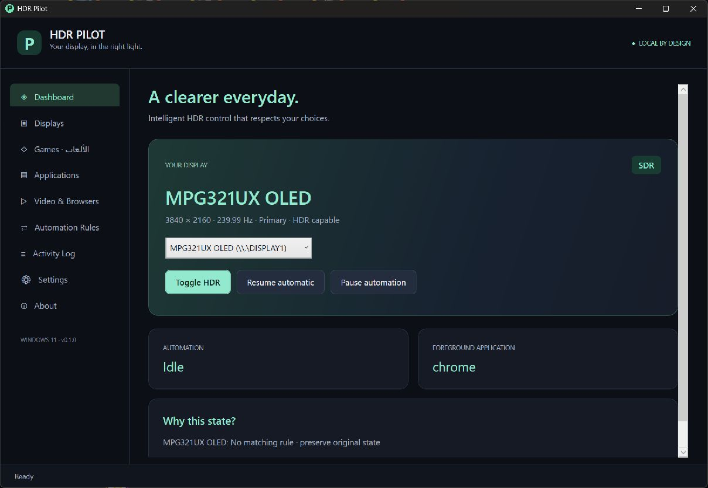

# HDR Pilot

Independent, local Windows HDR automation built with C#, .NET 10, and WPF.

[Download for Windows](https://github.com/hmh6a/hdr-pilot/releases/latest) · [Build status](https://github.com/hmh6a/hdr-pilot/actions)

**Release status: 0.1.2, unsigned Windows build.** Real Windows HDR switching and profile-driven restoration have been exercised on the development PC. This is not a claim of production certification across GPU vendors. See [validation](docs/VALIDATION.md) and [limitations](#known-limitations).

## Features

- Per-display HDR discovery, manual switching, and read-back verification.
- Safe, memory-only HDR ownership; preserve pre-existing HDR and yield to detected external changes.
- Application profiles matching full executable paths; fullscreen, foreground, running, force HDR, force SDR, and keep-current policies.
- Activation/deactivation delays, deterministic priorities, serialized transitions, cooldown, and cancellation.
- Read-only game discovery; manual executables and currently running applications; search, editing, disabling, and recently played timestamps.
- Dashboard, displays, games, applications, video, rules, logs, settings, and about pages.
- Tray operation, close/minimize to tray, per-user startup, configurable global shortcuts and conflict reporting.
- Optional notifications for each display's observed HDR changes, automation modes, and failures; an enable/test button in Settings.
- Atomic JSON settings, validation, schema migration backups, corruption recovery, settings import/export and bounded local logs.
- Optional YouTube playback companion for Chrome/Edge with a current-user named pipe. Video range is **user-classified**, not automatically inferred.
- Optional SDR-to-Windows-HDR requests for an externally configured NVIDIA RTX Video HDR workflow.

## Requirements and installation

Windows 11 x64, a local interactive desktop session, and a compatible display/driver for HDR. The portable release contains its own .NET runtime. Administrator access is not required. HDR support over Remote Desktop is not assumed.

**Recommended:** download `HDRPilot-0.1.2-win-x64-Setup.exe`, choose your installation folder on the destination page, then click Install. The installer adds a Start menu shortcut and an Apps & features uninstall entry; a desktop shortcut is optional. It installs for the current user and includes the browser companion and diagnostics. Choose any folder your account can write to. No separate .NET installation is needed.

For portable use, run `HDRPilot-0.1.2-win-x64.exe` directly, or extract the full `HDRPilot-0.1.2-win-x64.zip` and run `HDRPilot.exe`. Keep the native host and browser files in that folder if using the companion. No Windows service is installed. The build is unsigned; verify its source and checksums. Do not disable Windows security protections to run it.

## Usage

1. Open **Displays** and confirm Windows reports HDR capability. **Toggle this display** is an explicit manual change.
2. Open **Games · الألعاب**. Installed games appear automatically. Click **إعداد HDR** beside a game, review the display, then **حفظ البروفايل**. The Arabic quick setup selects a single executable automatically; ambiguous installations ask you to choose or open the game and refresh detection. Common crash reporters, installers and anti-cheat helpers are excluded from suggestions.
3. If a game is missing, open it and select it under **اللعبة مفتوحة الآن؟ → إضافة اللعبة المختارة**. This captures its executable path without a file picker. The list contains readable applications with windows, so select the game itself. Manual file selection remains available.
4. New game profiles follow the game window, use WhileRunning, and release owned HDR when the game closes or is minimized. Timing and priority are preset. **خيارات إضافية** contains advanced settings and an option to resume automation on save (enabled by default). Existing profiles retain their settings without making duplicates. The **تفعيل هذا البروفايل** checkbox enables or disables the profile. ProfilesOnly remains ProfilesOnly. A checkmark marks enabled games. Use Applications for advanced profile management.
5. Close the main window to keep monitoring. Double-click the tray icon to reopen. **Exit** in the tray or About page safely releases verified owned changes.

**ForceSdr and AlwaysSdr only release HDR Pilot-owned HDR.** They cannot turn off HDR that was already enabled externally. Use the manual button for that explicit user action. NeverModify holds the current state while its rule wins; restoration is reconsidered after it ends.

To confirm a change, check **Displays**: `HDR ON` means Windows HDR is enabled; `SDR` means it is off. Manual actions show the verified state in the status bar and Activity Log. Use **Settings → Enable & test notifications** to save the notification preference and send a test. Subsequent observed changes name the affected display, even when another monitor keeps HDR on. First discovery and reconnection are silent. Windows Do not disturb and notification settings can suppress banners; the display status remains available in the app.

The default shortcuts are Win+Alt+H (toggle), A (automatic), P (pause), and O (cycle automatic/always HDR/always SDR). Windows may reserve some combinations. Failures appear in Activity Log; the corresponding tray/UI action still works. Enable/disable each shortcut in Settings. To change keys, export JSON, edit `Hotkeys`, and import: `Modifiers` is Alt=1, Ctrl=2, Shift=4, Win=8; `Key` is the virtual-key integer. Do not use a shortcut already assigned elsewhere.

## HDR compatibility and ownership

Windows 11 build 26100+ uses SDK `GET_ADVANCED_COLOR_INFO_2` and `SET_HDR_STATE`, distinguishing WCG from HDR. Earlier Windows 11 uses the legacy advanced-color API and excludes WCG-enforced displays; this fallback is not hardware-validated here. Stable monitor device paths identify displays; no writes are allowed if stable identity is unavailable. Only active desktop paths are enumerated.

The display controller verifies every write. The engine keeps the startup state and its last verified change in memory. If a different state is observed, it gives control back until explicitly resumed. Hotplug, sleep/resume uncertainty, or query failures discard old ownership. This may deliberately leave HDR on. A crash never authorizes a later process to restore an old state.

Windows provides no writer identity or atomic compare-and-set. Same-state external writes, very short external transitions, and changes between a read and write cannot be reliably attributed. Do not run competing HDR automation tools. See [architecture](ARCHITECTURE.md).

## Video and NVIDIA

Follow [browser setup](browser/README.md). Playback/pause/end, fullscreen, focus, tab close, and connection loss influence automation. You must classify the current YouTube video as HDR or SDR in the popup; navigation resets it to Unknown. This avoids inventing a browser metadata API. Unknown content never requests HDR, even with the SDR workflow enabled.

NVIDIA adapter presence is detected from active display associations. RTX Video capability and processing status are not queried. Configure RTX Video HDR yourself in NVIDIA App or supported Control Panel settings; HDR Pilot never writes NVIDIA registry keys. Windows HDR is separate from the driver's video enhancement. [NVIDIA's setup instructions](https://nvidia.custhelp.com/app/answers/detail/a_id/5448).

VLC, MPC-HC, MPC-BE, mpv, PotPlayer and Windows Media Player can use basic executable/window profiles. No claim is made that their active content is HDR.

## What changes in Windows

- Selected display's Windows HDR state through User32 display APIs, only when requested by a user action or eligible policy.
- `%AppData%\HDRPilot\config.json`, atomic backups, and corruption/migration backups.
- `%LocalAppData%\HDRPilot\logs\hdrpilot.log` plus three rotating files, approximately 1 MiB each.
- **Only if opted in:** `HKCU\Software\Microsoft\Windows\CurrentVersion\Run\HDRPilot`.
- **Only if the registration script is run:** Chrome/Edge native-host keys in HKCU and `%LocalAppData%\HDRPilot\browser\host.json`.
- Transient hotkey registrations, window event hooks, a session mutex/event, and current-user named pipes. No keyboard hooks or persistent desktop overlay.

## Troubleshooting

- **No HDR support / API error:** check Windows Display settings, cable/port, driver, console session, and policy. No silent legacy fallback is used on 24H2+ when the newer API fails.
- **Manual override:** press Resume automatic after deciding HDR Pilot should control the display again.
- **No profile match:** use the full game executable path, a visible/non-minimized qualifying window, correct target display, and enabled profile. A preferred monitor plus WhileRunning with minimized handling disabled also supports a process without a visible window.
- **Rapid focus switching:** increase profile delays and global cooldown. Deactivation can be cancelled when the application qualifies again.
- **Startup entry points to an old folder:** disable and re-enable Start with Windows after moving the portable folder.
- **Browser offline:** check the extension ID registration, host executable location, enabled bridge, and foreground YouTube tab. Reload the tab after installation.
- **Configuration recovery notice:** original corrupted input is preserved. A newer schema or unreadable file disables saving to avoid data loss.
- **Logs:** filter/export from Activity Log. Review application/profile names before sharing a report.

## Known limitations

- One physical NVIDIA-driven monitor was tested. Multi-monitor behavior, AMD/Intel HDR writes, sleep/wake/hotplug/driver resets, and legacy HDR APIs need broader physical testing. Unit tests cover policy behavior, not hardware compatibility.
- Automation detects a process/window after launch. Games that cache HDR capability at startup may require HDR to be enabled manually before launching; HDR Pilot does not inject into or relaunch games.
- Game discovery is best-effort. Steam/Epic manifest formats and launcher registry metadata can change. Xbox scans accessible `XboxGames` installations; protected Microsoft Store packages and some launcher-managed installs require manual addition. No launcher files are modified.
- YouTube range classification is manual. The companion is not installed automatically and has not been end-to-end validated inside Chrome/Edge in this environment. Protocol and local pipe tests pass.
- No advanced video-player metadata integrations, RTX driver control, MSIX installer, signed binaries, or authenticated update infrastructure are included.
- Update checks/installations are disabled. Download new versions from [official releases](https://github.com/hmh6a/hdr-pilot/releases); signing is not configured. Never treat a checksum beside a binary as proof of publisher identity.
- WPF uses meaningful memory; see measured figures in validation. No claimed universal CPU/RAM target or OLED burn-in prevention.

## Uninstallation

For an installed copy, exit HDR Pilot from its tray and uninstall HDR Pilot in Windows Settings → Apps → Installed apps. The uninstaller preserves settings and logs; it removes the startup entry only if that entry points to the installation being removed. Unregister any manually configured browser bridge before uninstalling.

For a portable copy, exit HDR Pilot from its tray. Disable Start with Windows first, or remove its named HKCU Run value. Run `scripts/Unregister-BrowserBridge.ps1` if registered and remove the browser extension. Delete the extracted portable folder. Settings/logs remain unless you choose to delete the HDRPilot folders under AppData and LocalAppData. No system-wide service or driver needs removal.

## Development

See [BUILDING.md](BUILDING.md), [ARCHITECTURE.md](ARCHITECTURE.md), [SECURITY.md](SECURITY.md), and [CONTRIBUTING.md](CONTRIBUTING.md). Licensed under [MIT](LICENSE). SmartHdrManager was a functional reference; its source and visual assets were not copied.
